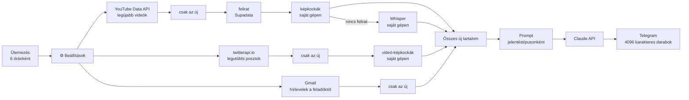

# Content Digest — n8n workflow

Néhány YouTube-csatornát, X-fiókot és hírlevelet követek, és nem akarom
mindet végignézni. Ez a workflow hat óránként összeszedi az új tartalmat,
Claude-dal magyar nyelvű jelentést írat belőle, és elküldi egy Telegram-csatornára.
Ugyanarról a videóról vagy posztról nem küld kétszer.

**A promptok befektetési információkra fókuszálnak.** A modell nem általános
összefoglalót ír, hanem kigyűjti, mit állít a figyelt befektető: melyik
eszközre milyen irányt, milyen árszinteket, milyen időtávra és mekkora
meggyőződéssel, és hogy van-e benne pénze. A grafikonokról leolvassa a
szinteket: az X-posztokhoz csatoltakról és a videókból kivágott képkockákról
is. Saját befektetési tanácsot nem ad.

A projekt egy Pythonban írt, Windows-ütemezővel futó rendszerem n8n-es
változata, és ugyanazokat a jelentésszabályokat használja. Az eredeti
Claude Code-dal írja a jelentést. Itt ugyanez a folyamat node-okból áll össze,
a szerkesztőben követhető, és bármilyen n8n-példányon elindul. A felirat
nélküli videókat egy saját gépen futó Whisper-szolgáltatás írja át, ugyanúgy,
mint az eredetiben.


## Hogyan működik



A figyelt forrásokat a `⚙️ Settings` node-ban kell megadni. Egy új csatorna
vagy fiók egy új sor a listában, a többi node-hoz nem kell nyúlni.

A három forrás külön ágon fut. Mindegyik ág végén egy Remove Duplicates node
szűr: az n8n végrehajtásokon át megjegyzi, mely elemeket látta már, így ehhez
nem kell külön adatbázis. A `lookbackHours` beállítás az első futásnál számít:
az ennél régebbi tartalom akkor sem kerül be, ha még sosem látta.

A külső API-hívások hiba esetén is továbbengedik a folyamatot (`On Error:
Continue`). Ha egy csatorna nem létezik, vagy az egyik API épp nem válaszol,
a többi forrásról ugyanúgy megjön a jelentés.

Ha a fő workflow hibára fut, a külön `error-alert.json` workflow szól
Telegramon.

### A jelentések típusai

Minden forráslista egy jelentéstípushoz tartozik, és mindegyik típusnak saját
promptja van. Típusonként egy Claude-hívás és egy külön Telegram-üzenet készül.

| Típus | Settings-lista | Mire való |
|---|---|---|
| `investor` | `youtubeChannels`, `xAccounts`, `emailSenders` | Befektetési elemzés személyenként: állítások, árszintek, időtáv, meggyőződés, a grafikonok kiolvasásával |
| `newsfeed` | `xNewsAccounts` | Naponta több tucat rövid posztot író hírfigyelő fiókok (pl. @aixbt_agent): projektenként csoportosítva, rangsorolva, a zaj nélkül |
| `explainer` | `explainerChannels` | Nem befektetési, ismeretterjesztő vagy önfejlesztési videók: részletes összefoglaló a gondolatmenettel, fogalmakkal, gyakorlati lépésekkel |

A promptok a `Build prompt` node elején vannak, magyarul. Az eredeti projekt
skilljeiből készültek, egyetlen API-híváshoz igazítva: a modell nem olvas
fájlt és nem használ eszközt, a kimenet pedig sima szöveg. A Telegram node itt
nem alakítja át a Markdownt, ezért a szerkezetet emojival kezdődő sorok és
üres sorok adják.

Egy dolog maradt ki az eredetiből: mivel a modellnek nincs előző jelentése,
nem tudja megmondani, mi változott a korábbiakhoz képest, csak ha maga a
szerző mondja.

### Grafikonok a videókban

A figyelt emberek a charton mutatják az árszintet, közben annyit mondanak:
„ennél a szintnél”. Ezért az átiratból gyakran hiányzik a szám. Az `investor`
típusnál a helyi szolgáltatás (`whisper-service/`) minden videóból képkockákat
is kivág, a YouTube-videókból és az X-posztokhoz csatolt videókból is:
letölti a képsávot, ffmpeg-gel megkeresi a jelenetváltásokat, és legfeljebb
`framesPerVideo` darabot tart meg, a videó teljes hosszán elosztva. Ha a
videóban nincs érdemi vágás (végig ugyanaz a chart), egyenletesen mintavételez.
A Claude a kockákat képként kapja, mindegyiket az elem számával és az
időponttal felcímkézve.

A kockák többsége beszélő fej, ezekről a prompt szerint nem ír a modell. A
`maxFramesPerReport` egy jelentés összes kockáját korlátozza, és egyenlően
osztja el a videók között; egy 1280×720-as kocka körülbelül 1200 bemeneti
token. Ha a szolgáltatás nem fut, a videó kocka nélkül megy tovább, és a
blokkjában `képkockák: NINCS` áll, így a modell nem ír olyan grafikonról, amit
nem látott. A `framesPerVideo: 0` kikapcsolja a képkockákat.

### Claude-előfizetés API-kulcs helyett

Alapból a jelentést az Anthropic API írja. Ha van Claude-előfizetésed, és a
helyi szolgáltatást futtató gépen telepítve és bejelentkezve van a Claude
Code, töltsd ki a `claudeUrl` mezőt (általában ugyanaz, mint a `whisperUrl`).
Ekkor a kérés a szolgáltatás `/claude` végpontjára megy: ez ugyanazzal a
prompttal és képekkel `claude -p`-t futtat, és az API formátumában válaszol. A
CLI eszközök, MCP-szerverek és beállítások nélkül, üres mappában fut, és az
`ANTHROPIC_API_KEY` kikerül a környezetéből, így az előfizetést használja. A
válaszban az is benne van, mennyibe került volna a hívás az API-n
(`costUsd`).

### Felirat nélküli videók

A YouTube-videóknál a felirat a nyersanyag. Először a Supadata adja a videó
saját feliratát. Ha nincs felirat (vagy nincs Supadata-kulcs), a videó a
Whisper-szolgáltatáshoz megy: ez a saját gépeden letölti a hangsávot, és
leiratja (`whisper-service/`). A jelentésben ott a jelölés, hogy gépi
átiratból készült, mert a nevek és a számok pontatlanok lehetnek.

Ha a szolgáltatás nem fut, vagy a videó hosszabb a korlátnál, a modell a videó
leírását kapja, és a jelentésben szerepel, hogy csak az volt elérhető. Ha
üresen hagyod a `whisperUrl` beállítást, ez a lépés kimarad.

## Telepítés

### 1. Az n8n elindítása

```bash
docker compose up -d
```

Utána nyisd meg a `http://localhost:5678` címet. n8n Cloudon vagy saját VPS-en
ugyanígy használható, de a Whisper-szolgáltatásnak akkor egy olyan gépen kell
futnia, amit az n8n elér.

### 2. A Whisper-szolgáltatás

Python 3.10+, ffmpeg és lehetőleg egy NVIDIA GPU kell hozzá. GPU nélkül is
fut, csak lassabban.

```bash
cd whisper-service
pip install -r requirements.txt
```

Indítás előtt adj meg egy legalább 16 karakteres véletlen tokent. Ugyanezt
kapja majd az n8n is:

```powershell
$env:WHISPER_TOKEN = "<véletlen érték>"
python server.py
```

A szolgáltatás a 8790-es porton figyel. Az n8n a Docker-konténerből a
`http://host.docker.internal:8790` címen éri el. Ha az n8n nem Dockerben fut,
hanem ugyanazon a gépen, a cím `http://localhost:8790`. Működik-e:
`http://localhost:8790/health`.

A többi beállítás környezeti változó: `WHISPER_PORT`, `WHISPER_MODEL` (alapból
`small`, 4 GB VRAM-on a `medium` már nem fér el), `WHISPER_MAX_MINUTES`
(alapból 180), `WHISPER_HOST` (alapból `0.0.0.0`, hogy a konténer elérje).
Egyszerre egy videót ír át, a többi kérés sorban vár. A képkockáknak saját
sora van, így nem várnak az átírásra. Képkockához csak YouTube-ról és X-ről
tölt le.

### 3. Import

Workflows → Import from File. Előbb a `workflows/error-alert.json`, utána a
`workflows/content-digest.json`.

### 4. Hitelesítő adatok (Credentials)

Hét hitelesítő adatot kell létrehozni, és hozzárendelni a megfelelő
node-okhoz.

A két YouTube-os HTTP node (uploads playlist, latest videos) Query Auth
típusú hitelesítést kap `key` névvel, az értéke a YouTube Data API v3 kulcs. A
felirat-node (Supadata) Header Auth-ot használ `x-api-key` névvel. Ez nem
kötelező: kulcs nélkül minden videó a Whisperhez megy. A Whisper-node, a két
képkocka-node (YouTube és X) és a `Claude: summarize (subscription)` node
ugyanazt a Header Auth-ot kapja, `X-Whisper-Token` névvel és a szolgáltatás
tokenjével. Az
X-es node `X-API-Key` névvel a twitterapi.io kulcsát kapja, a Claude-node pedig
`x-api-key` névvel az Anthropic API-kulcsot.

A Gmail-node OAuth2-vel kapcsolódik a saját postafiókodhoz. A két Telegram node
(send, error alert) a bot tokenjét kéri, amit a @BotFathertől kapsz.

A kulcsokat az n8n titkosítva tárolja. A repóban lévő workflow-fájlokban nincs
kulcs.

Ha valamelyik forrást nem használod (például nincs twitterapi.io-kulcsod),
hagyd üresen a hozzá tartozó listát a Settings node-ban. Akkor az az ág el sem
indul.

### 5. Beállítások

A `⚙️ Settings` node legfontosabb mezői:

```js
youtubeChannels:   ['UCjFCzjkgSShdRZIVJx3SSlQ'],   // investor
xAccounts:         ['ChifoiCristian'],             // investor
emailSenders:      ['newsletter@example.com'],     // investor
xNewsAccounts:     ['aixbt_agent'],                // newsfeed
explainerChannels: ['@tizeslista_hu'],             // explainer
whisperUrl:        'http://host.docker.internal:8790',
whisperLanguages:  ['hu', 'en', 'ro'],
framesPerVideo:    10,       // 0 = nincs képkocka
maxFramesPerReport: 30,
lookbackHours:     24,
telegramChatId:    '-100XXXXXXXXXX',
telegramChatIds:   { investor: '', newsfeed: '', explainer: '' },
model:             'claude-sonnet-5-5',
claudeUrl:         '',       // kitöltve Claude-előfizetéssel fut, lásd fent
```

A YouTube-csatornát `@handle` alakban és `UC...` kezdetű azonosítóval is meg
lehet adni. A `telegramChatIds` mezőben egy jelentéstípus saját csatornát
kaphat; üresen a `telegramChatId`-ra megy. A `whisperLanguages` azt adja meg,
milyen nyelvű hangsávot keressen a szolgáltatás. Sok videóhoz a YouTube
automatikus szinkronsávokat is tesz, és nélküle egy angol videó arab
szinkronnal is lejöhet.

### 6. Próba és élesítés

1. Futtasd a workflow-t a Manual trigger node-ról. Minden node-on látszik,
   hány elem ment át rajta.
2. A fő workflow Settings → Error workflow mezőjében válaszd ki a
   „Content Digest – error alert” workflow-t.
3. Kapcsold be (Active).

### Frissítés v1.0.0-ról

Az n8n magától nem húzza le az új verziót: a már importált workflow fut
tovább, amíg újra nem importálod.

1. Állítsd le és indítsd újra a helyi szolgáltatást (`python server.py`), hogy
   a `/frames` és a `/claude` végpont is fusson.
2. Másold ki a régi Settings node-ból a saját listáidat (csatornák, fiókok,
   chat-azonosítók), importáld újra a `workflows/content-digest.json`-t, és
   írd vissza őket.
3. Rendeld hozzá az `X-Whisper-Token` hitelesítést a három új node-hoz:
   `YouTube: frames (local)`, `X: frames (local)` és
   `Claude: summarize (subscription)`.
4. Ha Claude-előfizetéssel akarod íratni a jelentést, töltsd ki a
   `claudeUrl`-t.
5. Futtasd egyszer a Manual triggerről, és nézd meg az elemszámokat.

## Részletek

### Miért nem RSS-ből jönnek a videók?

A YouTube csatorna-RSS-e 2026 októbere
óta 404-et ad. A workflow ezért a hivatalos Data API-t hívja: először a
csatorna feltöltési lejátszási listáját kéri le (`channels`), utána annak
legújabb elemeit (`playlistItems`). Ez csatornánként és futásonként 2
kvótaegység, a napi ingyenes keret 10 000.

### Deduplikáció

Minden elem kap egy azonosítót (`youtube:<id>`, `x:<id>`,
`email:<id>`), a három „new … only” node ez alapján szűr. Ha mindent újra
látni szeretnél, futtasd a node-on a Clear Deduplication History műveletet.

### Üres ágak

A workflow `v1` végrehajtási sorrendet használ. Ha egy ágban
nincs új tartalom, a Merge a többi ág adataival megy tovább. Ha egyikben
sincs, a futás a Merge előtt véget ér, és nem megy ki üres üzenet.

### Költség

Futásonként jelentéstípusonként egy Claude-hívás van, tehát legfeljebb három.
A felső határt a `maxCharsPerItem` (alapból elemenként 40 000 karakter, ez
nagyjából egy 45 perces videó felirata) és a `maxImages` adja meg. A
rendszerpromptok típusonként 5-6 ezer karakteresek. A Whisper a saját gépeden
fut, annak nincs API-költsége.

## Tesztelés

Az eredeti változatot n8n 2.8.4-en teszteltem, egy helyi mock szerverrel a
YouTube, a Supadata, a twitterapi.io, az Anthropic és a Telegram API helyett.

A mock csatornánként egy friss és egy régi videót adott vissza, a régi a
`lookbackHours` miatt kimaradt. A felirat nélküli videónál a workflow a
leírásból dolgozott, és ezt a prompt jelezte. Egy nem létező csatorna hibát
adott, a többi forrás ettől még feldolgozódott. Üres hírlevél-listával az
e-mail-ág kimaradt, a Merge a másik kettővel ment tovább.

Az X-poszt grafikonja `image` blokkként jutott el a Claude-hoz. A hosszú
válaszból három Telegram-üzenet lett, mindegyik 4096 karakter alatt. A második
futás ugyanazzal az adattal már nem hívta a Claude-ot, és üzenetet sem küldött.

A Whisper-ággal és a jelentéstípusokkal bővített változatot ugyanígy, n8n
2.8.4-en, mock API-kkal teszteltem, de a Whisper-szolgáltatás valódi volt. A
mock egy valódi, felirat nélküli rövid videót adott vissza. A Supadata nem
talált hozzá feliratot, a videó a Whisperhez ment, és a Claude a gépi átiratot
kapta, `felirat: whisper (en)` jelöléssel. A három jelentéstípus három külön
Claude-hívás lett, a saját promptjával. A `newsfeed` típus a beállított külön
Telegram-csatornára ment, és a fiók mind a 12 posztja bekerült, nem csak az
első 5. A második futás ugyanazzal az adattal nem hívta a Claude-ot. Leállított
Whisper-szolgáltatás mellett egy új, felirat nélküli videó a leírásával ment
tovább, `felirat: NINCS` jelöléssel, és a futás sikeres maradt.

A szolgáltatás GPU-n egy rövid nyilvános videót 3-4 másodperc alatt írt át, a
hibás tokent és a hibás videóazonosítót visszautasította. A promptokat egy
nap valódi anyagán (30 befektetési elem és 9 hírfigyelő poszt) Claude-dal is
lefuttattam: a kimenet sima szöveg lett, Markdown-jelölés nélkül.

A videós képkockákat és az előfizetéses utat n8n 2.8.4-en, végig teszteltem.
A YouTube, a Supadata és a twitterapi.io mock volt, de valódi tartalommal: egy
7 perces VirtualBacon-videó a feliratával, egy Chifoi-poszt három charttal és
egy Chifoi-poszt, ami egy videót idéz. A képkocka-szolgáltatás és a Claude
valódi volt. Minden node egyszer futott. A videó 10 kockát kapott, az idézett
videó 8-at (a videó az idézett posztban van, ezért a `hasVideo` ott is
keres), a képes poszt elkerülte a képkocka-ágat, és a Claude 20 képet kapott.
A jelentést az előfizetés írta a `/claude` végponton át, 45 másodperc alatt,
és olyan szinteket is leolvasott a kockákról, amelyek a beszédben nem
hangzanak el. Önmagában a szolgáltatás a hibás tokent, a hibás
videóazonosítót és a YouTube-on és X-en kívüli URL-t visszautasította.

Az alábbi képernyőkép ez a futás, a szerkesztőből, a Manual triggerről
indítva. A Telegram is mock volt (a hitelesítés alap-URL-je a mockra
mutatott), így az üzenet a mockhoz ment, nem egy csatornába. A
`Gmail: newsletters` és a `Claude: summarize` node-on látható figyelmeztetés
csak azt jelzi, hogy a hitelesítésük nem volt hozzárendelve; egyik sem futott.


## Fájlok

```
workflows/content-digest.json    a fő workflow, benne a promptokkal
workflows/error-alert.json       hibajelző workflow (Error Trigger → Telegram)
whisper-service/server.py        helyi szolgáltatás: Whisper-átirat és videó-képkockák
whisper-service/requirements.txt a szolgáltatás Python-függőségei
docker-compose.yml               helyi n8n egy paranccsal
docs/                            képernyőképek
README.md                        angol nyelvű README
```
