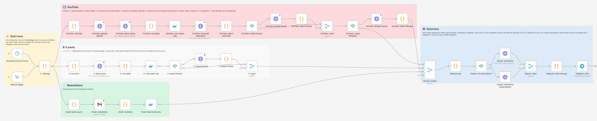
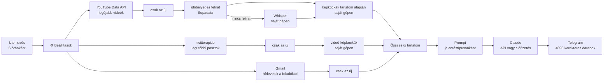
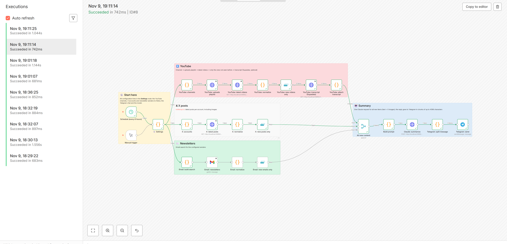

# Content Digest: n8n workflow YouTube-, X- és hírlevél-összefoglalókhoz

Ez a workflow hat óránként összeszedi az új tartalmat a figyelt
YouTube-csatornákról, X-fiókokról és hírlevelekből, Claude-dal magyar nyelvű
jelentést írat belőle, és elküldi Telegramra. Ugyanarról kétszer nem küld.

A promptok befektetési információkra fókuszálnak: melyik eszközről beszél a
figyelt befektető, milyen irányt, árszinteket és időtávot mond, mennyire biztos
benne, és van-e benne pénze. A szinteket a grafikonokról is leolvassa, az
X-posztok képeiről és a videókból kivágott képkockákról. Saját befektetési
tanácsot nem ad.

Egy Pythonban írt rendszerem n8n-es változata, ugyanazokkal a
jelentésszabályokkal. A promptok és a jelentések magyarok.



## Hogyan működik



- **Források:** a `⚙️ Settings` node-ban. Egy új csatorna vagy fiók egy új sor,
  más node-hoz nem kell nyúlni.
- **Deduplikáció:** minden ág végén egy Remove Duplicates node szűr, így nem
  kell adatbázis. Az első futásnál a `lookbackHours` dönti el, meddig néz
  vissza.
- **Hibák:** a külső hívások `On Error: Continue` beállítással futnak, így egy
  hibás forrás nem állítja meg a jelentést. Ha az egész workflow hibára fut, az
  `error-alert.json` szól Telegramon.
- **Grafikonok a videókban:** a figyelt emberek a chartra mutatnak, és annyit
  mondanak: „ennél a szintnél”, ezért a szám gyakran hiányzik az átiratból. Egy
  helyi szolgáltatás minden videóból képkockákat vág, főleg azokban a
  pillanatokban, amikor a beszélő a képernyőre mutat vagy számot mond, és a
  Claude a kockákat az akkor elhangzó mondattal felcímkézve kapja.
- **Felirat nélküli videók:** ezeket a Whisper írja át a saját gépeden. A
  jelentés ilyenkor jelzi, hogy a nevek és a számok pontatlanok lehetnek.

### A jelentések típusai

Minden típusnak saját promptja, saját Claude-hívása és saját Telegram-üzenete van.

| Típus | Settings-lista | Mire való |
|---|---|---|
| `investor` | `youtubeChannels`, `xAccounts`, `emailSenders` | Befektetési elemzés személyenként: állítások, szintek, időtáv, meggyőződés, a grafikonokkal együtt |
| `newsfeed` | `xNewsAccounts` | Naponta több tucat rövid posztot író fiókok (pl. @aixbt_agent): projektenként, a zaj nélkül |
| `explainer` | `explainerChannels` | Nem befektetési, ismeretterjesztő videók: a gondolatmenet, a fogalmak és a gyakorlati lépések |

A promptok a `Build prompt` node elején vannak. A kimenet sima szöveg, emojival
kezdődő sorokkal tagolva, mert a Telegram node nem alakítja át a Markdownt. Az
eredetivel szemben a modell nem látja az előző jelentést, így azt sem tudja
megmondani, mi változott azóta.

### Claude: API-kulcs vagy előfizetés

A Settings node `claudeUrl` mezője választ:

| | Anthropic API | Claude-előfizetés |
|---|---|---|
| `claudeUrl` | üres | a helyi szolgáltatás címe |
| Mi kell hozzá | Anthropic API-kulcs | bejelentkezett Claude Code a helyi szolgáltatás gépén |
| Fizetés | hívásonként | az előfizetés fedezi |

Mindkettő ugyanazt a promptot és képeket kapja. Előfizetésnél a helyi
szolgáltatás eszközök és beállítások nélkül futtatja a `claude -p`-t, és az API
formátumában válaszol.

### Biztonság

A jelentés mások posztjaiból, átirataiból és hírleveleiből készül, és bármelyik
tartalmazhat a modellnek szóló szöveget (prompt injection). Három dolog
korlátozza, mire mehet vele:

- **A modellnek nincs eszköze.** Az API-n szöveget és képeket kap, és szöveget
  ad vissza. Előfizetésnél a helyi szolgáltatás eszközök, MCP-szerverek és
  beállítások nélkül, üres mappában futtatja a `claude -p`-t. Fájlt nem olvashat
  és nem írhat, parancsot nem futtathat.
- **A prompt a forrásokat adatnak veszi.** Ha egy elemben „az AI-nak” szóló
  utasítás van, a modell kihagyja, és egy fix sorban jelzi, a tartalmát nem
  ismétli meg.
- **Kimeneti ellenőrzés Telegram előtt** (az `Output check` node; kód, nem
  modell). Link csak egy elem saját URL-je lehet, vagy olyan, ami a forrásban
  is szerepel, és megbízható oldalra mutat (x.com, YouTube, `trustedLinkHosts`,
  az elemek saját oldalai). Kulcsra vagy tokenre hasonlító szöveg nem lehet
  benne. Ami nem megy át, az az okokkal az `alertChatId`-ra megy, a csatornára
  soha.

## Telepítés

**1. Az n8n indítása:** `docker compose up -d`, utána `http://localhost:5678`.
n8n Cloudon vagy VPS-en is működik, ha eléri a helyi szolgáltatást.

**2. A helyi szolgáltatás indítása** (Whisper, képkockák, Claude-előfizetés).
Python 3.10+ és ffmpeg kell hozzá; NVIDIA GPU-val gyorsabb, de nélküle is fut.

```powershell
cd whisper-service
pip install -r requirements.txt
$env:WHISPER_TOKEN = "<véletlen érték, legalább 16 karakter>"
python server.py
```

A 8790-es porton figyel. Az n8n a Docker-konténerből a
`http://host.docker.internal:8790` címen éri el; működik-e:
`http://localhost:8790/health`. Nem kötelező környezeti változók:
`WHISPER_MODEL` (alapból `small`), `WHISPER_MAX_MINUTES` (180), `WHISPER_PORT`,
`WHISPER_HOST`.

**3. Import:** előbb a `workflows/error-alert.json`, utána a
`workflows/content-digest.json` (Workflows → Import from File).

**4. Hitelesítő adatok.** A megfelelő node-okhoz rendeld hozzá:

| Node | Típus | Név | Érték |
|---|---|---|---|
| YouTube (2 HTTP node) | Query Auth | `key` | YouTube Data API v3 kulcs |
| Felirat (Supadata), nem kötelező | Header Auth | `x-api-key` | Supadata-kulcs |
| Whisper, képkockák (2), Claude-előfizetés | Header Auth | `X-Whisper-Token` | a szolgáltatás tokenje |
| X | Header Auth | `X-API-Key` | twitterapi.io-kulcs |
| Claude: summarize (csak API) | Header Auth | `x-api-key` | Anthropic API-kulcs |
| Gmail | Gmail OAuth2 | | a postafiókod |
| Telegram (send, error alert) | Telegram | | bot token a @BotFathertől |
| Eval: webhook (csak evalhoz) | Header Auth | `X-Eval-Token` | egy véletlen token |

A workflow-fájlokban nincs kulcs. Ha egy forrást nem használsz, hagyd üresen a
listáját, és az az ág el sem indul.

**5. Beállítások.** A `⚙️ Settings` node legfontosabb mezői:

```js
youtubeChannels:   ['UCjFCzjkgSShdRZIVJx3SSlQ'],   // investor; @handle is jó
xAccounts:         ['ChifoiCristian'],             // investor
emailSenders:      ['newsletter@example.com'],     // investor
xNewsAccounts:     ['aixbt_agent'],                // newsfeed
explainerChannels: ['@tizeslista_hu'],             // explainer
whisperUrl:        'http://host.docker.internal:8790',
whisperLanguages:  ['hu', 'en', 'ro'],  // melyik hangsávot töltse le (a gépi szinkron helyett)
framesPerVideo:    10,                  // 0 = nincs képkocka
maxFramesPerReport: 30,
lookbackHours:     24,
telegramChatId:    '-100XXXXXXXXXX',
telegramChatIds:   { investor: '', newsfeed: '', explainer: '' },  // típusonkénti csatorna, nem kötelező
model:             'claude-sonnet-5-5',
claudeUrl:         '',                  // üres: API; a szolgáltatás címe: előfizetés
alertChatId:       '',                  // a privát chated: ide mennek a visszatartott jelentések
trustedLinkHosts:  ['theliquiditymap.com'],  // további oldalak, amelyek linkje szerepelhet
```

`alertChatId` nélkül a visszatartott jelentésről csak egy rövid értesítés megy
a `telegramChatId`-ra, a szövege az n8n végrehajtási naplójában marad.

**6. Próba és élesítés.** Futtasd a Manual triggerről, a workflow beállításaiban
az Error workflow legyen a „Content Digest – error alert”, aztán kapcsold be.

**Frissítés:** az n8n magától nem húzza le az új verziót. Mentsd ki a listáidat
a Settings node-ból, importáld újra a `workflows/content-digest.json`-t, írd
vissza a listákat, és rendeld hozzá újra a hitelesítéseket. A változások a
release-jegyzetekben vannak.

## Eval

Az `Eval: webhook` node-dal rögzített bemeneten mérheted a jelentések
minőségét. Az `All new content` node kimenetével azonos alakú elemeket küldesz,
és a jelentés a kimeneti ellenőrzés ítéletével együtt jön vissza. Gyűjtés nem
fut, Telegramra semmi nem megy. A workflow-nak aktívnak kell lennie.

```bash
curl -X POST http://localhost:5678/webhook/content-digest-eval \
  -H "X-Eval-Token: <token>" -H "Content-Type: application/json" \
  -d '{"items": [{"uid": "x:1", "source": "x", "profile": "investor",
       "author": "Investor X (@investorx)", "title": "BTC", "published": "2026-11-14T08:00:00Z",
       "url": "https://x.com/investorx/status/1", "text": "BTC holding the 78k support."}]}'
```

A válasz jelentésenként egy objektum: `text`, `findings`, `held`, `profile`. A
kérés a `settings` alatt felülírhatja a `model`, `claudeUrl`,
`maxFramesPerReport`, `maxCharsPerItem`, `maxImages` és `trustedLinkHosts`
beállítást. Képek és képkockák a kérésben is küldhetők (`images` `data:`
URL-ként, `frames` base64-ben, ahogy a helyi szolgáltatás is adja).

Az ezt használó eszközök az [`eval/`](eval/README.md) mappában vannak: egy
futtató, ami kóddal pontozza a jelentéseket, egy LLM-bíró (alapból nem
Claude-modell) és prompt-injection támadások, két kitalált bemutató esettel.

## Részletek

- **Miért nem RSS:** a YouTube csatorna-RSS-e 2026 októbere óta 404-et ad, ezért
  a workflow a Data API-t hívja (csatornánként és futásonként 2 kvótaegység, a
  napi keret 10 000).
- **Költség:** futásonként legfeljebb három Claude-hívás, jelentéstípusonként
  egy. A méretüket a `maxCharsPerItem`, a `maxImages` és a `maxFramesPerReport`
  korlátozza (egy képkocka kb. 1200 bemeneti token). A Whisper és a képkockák
  helyben, ingyen futnak.
- **Tesztelés:** n8n 2.8.4-en, valódi tartalommal (YouTube-videó, grafikonos
  posztok, idézett videó), a külső API-k mockjával, élesben futó helyi
  szolgáltatással és előfizetéses Claude-dal. A biztonsági réteg ugyanígy:
  a tiszta jelentés a csatornára megy, az adathalász linkes vagy tokenes
  visszatartva csak az `alertChatId`-ra, eval módban pedig semmi nem megy ki.



## Fájlok

```
workflows/content-digest.json    a fő workflow, benne a promptokkal
workflows/error-alert.json       hibajelző workflow (Error Trigger → Telegram)
whisper-service/server.py        helyi szolgáltatás: Whisper, képkockák, Claude-előfizetés
whisper-service/moments.py       a képkockák pillanatait választja az időbélyeges átiratból
docker-compose.yml               helyi n8n egy paranccsal
eval/                            eval: futtató, pontozó, LLM-bíró, red team, bemutató esetek
README.md                        angol nyelvű README
```
