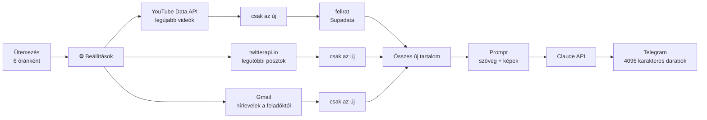

# Content Digest — n8n workflow

Néhány YouTube-csatornát, X-fiókot és hírlevelet követek, és nem akarom
mindet végignézni. Ez a workflow hat óránként összeszedi az új tartalmat,
Claude-dal magyar összefoglalót írat belőle, és elküldi egy Telegram-csatornára.
Ugyanarról a videóról vagy posztról nem küld kétszer.

A projekt egy Pythonban írt, Windows-ütemezővel futó rendszerem n8n-es
változata. Az eredeti helyi Whisperrel ír át hangot és Claude Code-dal írja a
jelentést. Itt ugyanez a folyamat node-okból áll össze, a szerkesztőben
követhető, és bármilyen n8n-példányon elindul.


## Hogyan működik



A figyelt forrásokat a `⚙️ Beállítások` node-ban kell megadni. Egy új csatorna
vagy fiók egy új sor a listában, a többi node-hoz nem kell nyúlni.

A három forrás külön ágon fut. Mindegyik ág végén egy Remove Duplicates node
szűr: az n8n végrehajtásokon át megjegyzi, mely elemeket látta már, így ehhez
nem kell külön adatbázis. A `lookbackHours` beállítás az első futásnál számít:
az ennél régebbi tartalom akkor sem kerül be, ha még sosem látta.

A külső API-hívások hiba esetén is továbbengedik a folyamatot (`On Error:
Continue`). Ha egy csatorna nem létezik, vagy az egyik API épp nem válaszol,
a többi forrásról ugyanúgy megjön az összefoglaló.

A YouTube-videóknál a felirat a nyersanyag. Ha nincs felirat, a modell a videó
leírását kapja meg, és a promptban szerepel, hogy csak az volt elérhető. Az
X-posztok képei URL-ként mennek a Claude-nak, így a grafikonokon lévő
árszinteket is ki tudja olvasni.

Ha a fő workflow hibára fut, a külön `error-alert.json` workflow szól
Telegramon.

## Telepítés

### 1. Az n8n elindítása

```bash
docker compose up -d
```

Utána nyisd meg a `http://localhost:5678` címet. n8n Cloudon vagy saját VPS-en
ugyanígy használható.

### 2. Import

Workflows → Import from File. Előbb a `workflows/error-alert.json`, utána a
`workflows/content-digest.json`.

### 3. Hitelesítő adatok (Credentials)

Hat hitelesítő adatot kell létrehozni, és hozzárendelni a megfelelő
node-okhoz.

A két YouTube-os HTTP node (feltöltési lista, legújabb videók) Query Auth
típusú hitelesítést kap `key` névvel, az értéke a YouTube Data API v3 kulcs. A
felirat-node (Supadata) Header Auth-ot használ `x-api-key` névvel. Ez nem
kötelező: kulcs nélkül a videók leírásából készül az összefoglaló. Az X-es node
szintén Header Auth-ot kap, `X-API-Key` névvel és a twitterapi.io kulccsal, a
Claude-node pedig `x-api-key` névvel és az Anthropic API-kulccsal.

A Gmail-node OAuth2-vel kapcsolódik a saját postafiókodhoz. A két Telegram node
(küldés, hibajelzés) a bot tokenjét kéri, amit a @BotFathertől kapsz.

A kulcsokat az n8n titkosítva tárolja. A repóban lévő workflow-fájlokban nincs
kulcs.

Ha valamelyik forrást nem használod (például nincs twitterapi.io-kulcsod),
hagyd üresen a hozzá tartozó listát a Beállításokban. Akkor az az ág el sem
indul.

### 4. Beállítások

A `⚙️ Beállítások` node legfontosabb mezői:

```js
youtubeChannels: ['@tizeslista_hu', 'UCjFCzjkgSShdRZIVJx3SSlQ'],
xAccounts:       ['ChifoiCristian'],
emailSenders:    ['newsletter@example.com'],
lookbackHours:   24,
telegramChatId:  '-100XXXXXXXXXX',
model:           'claude-sonnet-5-5',
```

A YouTube-csatornát `@handle` alakban és `UC...` kezdetű azonosítóval is meg
lehet adni.

### 5. Próba és élesítés

1. Futtasd a workflow-t a Kézi indítás triggerről. Minden node-on látszik,
   hány elem ment át rajta.
2. A fő workflow Settings → Error workflow mezőjében válaszd ki a
   „Content Digest – error alert” workflow-t.
3. Kapcsold be (Active).

## Részletek

### Miért nem RSS-ből jönnek a videók?

A YouTube csatorna-RSS-e 2026 októbere
óta 404-et ad. A workflow ezért a hivatalos Data API-t hívja: először a
csatorna feltöltési lejátszási listáját kéri le (`channels`), utána annak
legújabb elemeit (`playlistItems`). Ez csatornánként és futásonként 2
kvótaegység, a napi ingyenes keret 10 000.

### Deduplikáció

Minden elem kap egy azonosítót (`youtube:<id>`, `x:<id>`,
`email:<id>`), a három „csak az új …” node ez alapján szűr. Ha mindent újra
látni szeretnél, futtasd a node-on a Clear Deduplication History műveletet.

### Üres ágak

A workflow `v1` végrehajtási sorrendet használ. Ha egy ágban
nincs új tartalom, a Merge a többi ág adataival megy tovább. Ha egyikben
sincs, a futás a Merge előtt véget ér, és nem megy ki üres üzenet.

### Költség

Futásonként egy Claude-hívás van. A felső határát a
`maxCharsPerItem` (alapból elemenként 12 000 karakter) és a `maxImages` adja
meg.

## Tesztelés

n8n 2.8.4-en teszteltem, egy helyi mock szerverrel a YouTube, a Supadata, a
twitterapi.io, az Anthropic és a Telegram API helyett.

A mock csatornánként egy friss és egy régi videót adott vissza, a régi a
`lookbackHours` miatt kimaradt. A felirat nélküli videónál a workflow a
leírásból dolgozott, és ezt a prompt jelezte. Egy nem létező csatorna hibát
adott, a többi forrás ettől még feldolgozódott. Üres hírlevél-listával az
e-mail-ág kimaradt, a Merge a másik kettővel ment tovább.

Az X-poszt grafikonja `image` blokkként jutott el a Claude-hoz. A hosszú
válaszból három Telegram-üzenet lett, mindegyik 4096 karakter alatt. A második
futás ugyanazzal az adattal már nem hívta a Claude-ot, és üzenetet sem küldött.


## Fájlok

```
workflows/content-digest.json    a fő workflow
workflows/error-alert.json       hibajelző workflow (Error Trigger → Telegram)
docker-compose.yml               helyi n8n egy paranccsal
docs/                            képernyőképek
README.md                        angol nyelvű README
```
