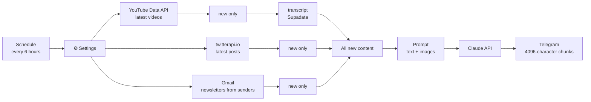

# Content Digest — an n8n workflow for YouTube, X and newsletter summaries

I follow a handful of YouTube channels, X accounts and newsletters, and I don't
want to go through all of them. Every six hours this workflow collects what's
new, has Claude write a summary in Hungarian, and posts it to a Telegram
channel. It never reports the same video or post twice.

It's an n8n port of a system I originally wrote in Python, which runs on the
Windows Task Scheduler, transcribes audio locally with Whisper and writes its
reports with Claude Code. Here the same pipeline is built from n8n nodes, so
you can follow it step by step in the editor and run it on any n8n instance.

The node names and the generated summaries are in Hungarian.


## How it works



You list the sources to follow in the `⚙️ Beállítások` (Settings) node. Adding
a channel or an account is one new line in a list; no other node needs to
change.

Each source runs in its own branch, and each branch ends in a Remove Duplicates
node. n8n remembers across executions which items it has already seen, so no
separate database is needed. The `lookbackHours` setting matters on the first
run: anything older than that is skipped even though it has never been seen.

External API calls are set to `On Error: Continue`. If a channel doesn't exist
or one of the APIs is down, the summary for the other sources still goes out.

For YouTube videos the transcript is the raw material. When a video has no
transcript, the model gets the video description instead, and the prompt says
that only the description was available. Images attached to X posts are passed
to Claude by URL, so it can read price levels off the charts.

If the main workflow fails, a separate workflow (`error-alert.json`) sends a message on Telegram.

## Setup

### 1. Start n8n

```bash
docker compose up -d
```

Then open `http://localhost:5678`. It works the same way on n8n Cloud or on
your own VPS.

### 2. Import

Go to Workflows → Import from File. Import `workflows/error-alert.json` first,
then `workflows/content-digest.json`.

### 3. Credentials

You need six credentials, each attached to the matching nodes.

The two YouTube HTTP nodes (feltöltési lista, legújabb videók: upload playlist
and latest videos) use a Query Auth credential named `key`, with your YouTube
Data API v3 key as the value. The transcript node (felirat, Supadata) uses
Header Auth named `x-api-key`. It's optional: without it, summaries are based
on the video descriptions. The X node also uses Header Auth, named `X-API-Key`
with your twitterapi.io key, and the Claude node uses `x-api-key` with your
Anthropic API key.

The Gmail node connects to your mailbox with Gmail OAuth2. The two Telegram
nodes (küldés and hibajelzés: send and error alert) need your bot token from
@BotFather.

n8n stores the keys encrypted. The workflow files in this repository contain no
keys.

If you don't use a source (say you have no twitterapi.io key), leave its list
empty in the Settings node and that branch won't run at all.

### 4. Settings

The main fields of the `⚙️ Beállítások` node:

```js
youtubeChannels: ['@tizeslista_hu', 'UCjFCzjkgSShdRZIVJx3SSlQ'],
xAccounts:       ['ChifoiCristian'],
emailSenders:    ['newsletter@example.com'],
lookbackHours:   24,
telegramChatId:  '-100XXXXXXXXXX',
model:           'claude-sonnet-5-5',
```

A YouTube channel can be given either as an `@handle` or as a channel ID
starting with `UC`.

### 5. Test run and activation

1. Run the workflow from the Kézi indítás (manual trigger) node. Each node
   shows how many items passed through it.
2. In the main workflow's Settings → Error workflow field, select
   "Content Digest – error alert".
3. Turn the workflow on (Active).

## Details

### Why not RSS?

YouTube's channel RSS feeds have returned 404 since October 2026, so the
workflow uses the official Data API. It first looks up the channel's uploads
playlist (`channels`), then fetches the latest items from it
(`playlistItems`). That costs 2 quota units per channel per run, against a free
daily quota of 10,000.

### Deduplication

Every item gets an ID (`youtube:<id>`, `x:<id>`, `email:<id>`), and the three
"csak az új" (new only) nodes filter on it. To see everything again, run the
Clear Deduplication History operation on those nodes.

### Empty branches

The workflow uses the `v1` execution order. If one branch has nothing new, the
Merge node continues with the data from the others. If none of them has
anything, the run stops before the Merge and no empty message is sent.

### Cost

Each run makes a single Claude call. Its size is capped by `maxCharsPerItem`
(12,000 characters per item by default) and `maxImages`.

## Testing

I tested the workflow on n8n 2.8.4 against a local mock server standing in for
the YouTube, Supadata, twitterapi.io, Anthropic and Telegram APIs.

The mock returned one recent and one old video per channel, and the old one
was dropped because of `lookbackHours`. For a video without a transcript, the
workflow worked from the description and the prompt said so. A channel that
doesn't exist returned an error, and the other sources were still processed.
With an empty newsletter list the email branch was skipped, and the Merge node
continued with the other two.

The chart attached to an X post reached Claude as an `image` block. A long
response was split into three Telegram messages, each under 4096 characters.
A second run with the same data made no Claude call and sent no message.


## Files

```
workflows/content-digest.json    the main workflow
workflows/error-alert.json       error alert workflow (Error Trigger → Telegram)
docker-compose.yml               local n8n with one command
docs/                            screenshots
README.hu.md                     this README in Hungarian
```
