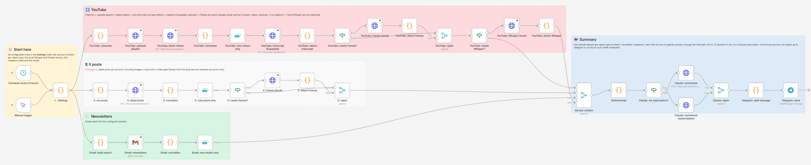
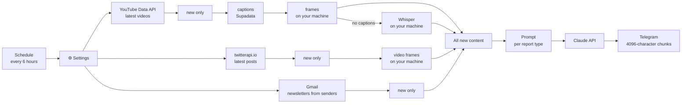
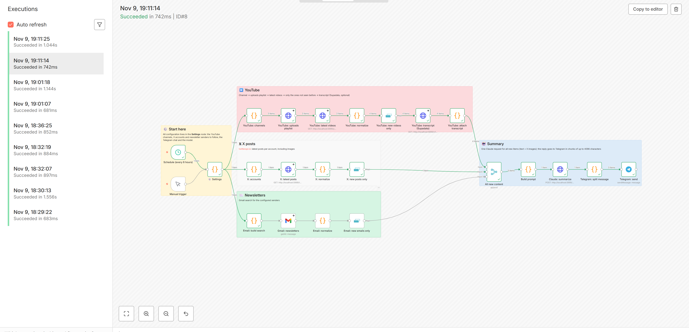

# Content Digest — an n8n workflow for YouTube, X and newsletter summaries

I follow a handful of YouTube channels, X accounts and newsletters, and I don't
want to go through all of them. Every six hours this workflow collects what's
new, has Claude write a report in Hungarian, and posts it to a Telegram
channel. It never reports the same video or post twice.

**The prompts focus on investment information.** Instead of a generic
summary, the model pulls out what each followed investor claims: which asset,
which direction, which price levels, over what time frame, how strongly they
believe it, and whether they have money in it. It reads the levels off the
charts, both the ones attached to X posts and frames cut from the videos. It
never gives investment advice of its own.

It's an n8n port of a system I originally wrote in Python, which runs on the
Windows Task Scheduler and writes its reports with Claude Code, and it uses the
same report rules. Here the pipeline is built from n8n nodes, so you can
follow it step by step in the editor and run it on any n8n instance. Videos
without captions are transcribed by a Whisper service running on your own
machine, just like in the original.

The prompts and the reports are in Hungarian.



## How it works



You list the sources to follow in the `⚙️ Settings` node. Adding
a channel or an account is one new line in a list; no other node needs to
change.

Each source runs in its own branch, and each branch ends in a Remove Duplicates
node. n8n remembers across executions which items it has already seen, so no
separate database is needed. The `lookbackHours` setting matters on the first
run: anything older than that is skipped even though it has never been seen.

External API calls are set to `On Error: Continue`. If a channel doesn't exist
or one of the APIs is down, the report for the other sources still goes out.

If the main workflow fails, a separate workflow (`error-alert.json`) sends a message on Telegram.

### Report types

Every source list belongs to a report type, and each type has its own prompt.
Each type gets one Claude call and its own Telegram message.

| Type | Settings lists | What it's for |
|---|---|---|
| `investor` | `youtubeChannels`, `xAccounts`, `emailSenders` | Investment analysis per person: claims, price levels, time frame, conviction, read off the charts too |
| `newsfeed` | `xNewsAccounts` | News accounts posting dozens of short items a day (e.g. @aixbt_agent): grouped by project, ranked, noise left out |
| `explainer` | `explainerChannels` | Non-investment educational or self-development videos: a detailed walkthrough of the argument, key concepts and practical steps |

The prompts sit at the top of the `Build prompt` node, in Hungarian. They are
adapted from the original project's skills for a single API call: the model
reads no files and uses no tools, and the output is plain text. The Telegram
node doesn't render Markdown here, so the structure comes from lines that
start with an emoji and from blank lines.

One thing from the original is left out: since the model has no previous
report, it can't tell what changed since last time unless the author says so.

### Charts in videos

The people this workflow follows draw their price levels on a chart while
saying "at this level", so the transcript alone often misses the numbers. For
the `investor` report type the local service (`whisper-service/`) also cuts
frames from every video, the YouTube ones and the videos attached to X posts:
it downloads the picture track, finds the scene changes with ffmpeg and keeps
up to `framesPerVideo` of them, spread over the whole video. If the video has
no real cuts (one chart shown throughout), it samples evenly instead. Claude
gets the frames as images, each labelled with its item and timestamp.

Most frames show a talking head, and the prompt tells the model to ignore
those. `maxFramesPerReport` caps the frames per report and is shared evenly
between the videos; a 1280×720 frame costs about 1,200 input tokens. If the
service isn't running, the video goes on without frames, and its block says
`képkockák: NINCS`, so the model doesn't write about charts it hasn't seen.
Set `framesPerVideo` to 0 to turn frames off.

### Claude subscription instead of an API key

By default the reports are written through the Anthropic API. If you have a
Claude subscription and Claude Code installed and logged in on the machine
that runs the local service, set `claudeUrl` (usually the same address as
`whisperUrl`). The request then goes to the service's `/claude` endpoint,
which runs `claude -p` with the same prompt and images and answers in the
API's format. The CLI runs without tools, MCP servers or settings, in an empty
folder, and `ANTHROPIC_API_KEY` is removed from its environment so the
subscription is used. The reply also carries what the call would have cost on
the API (`costUsd`).

### Videos without captions

For YouTube videos the captions are the raw material. Supadata fetches the
video's own captions first. If there are none (or there's no Supadata key), the
video goes to the Whisper service, which downloads the audio track on your
machine and transcribes it (`whisper-service/`). The report then notes that it
is based on a machine transcript, because names and numbers may be off.

If the service isn't running, or the video is longer than its limit, the model
gets the video description instead, and the report says that only the
description was available. Leave `whisperUrl` empty to skip this step.

## Setup

### 1. Start n8n

```bash
docker compose up -d
```

Then open `http://localhost:5678`. It works the same way on n8n Cloud or on
your own VPS, but then the Whisper service has to run on a machine that n8n can
reach.

### 2. The Whisper service

It needs Python 3.10+, ffmpeg and preferably an NVIDIA GPU. It runs without a
GPU too, only slower.

```bash
cd whisper-service
pip install -r requirements.txt
```

Before starting it, set a random token of at least 16 characters. n8n will
send the same value:

```powershell
$env:WHISPER_TOKEN = "<random value>"
python server.py
```

The service listens on port 8790. From the Docker container, n8n reaches it at
`http://host.docker.internal:8790`. If n8n runs on the same machine without
Docker, use `http://localhost:8790`. To check that it's up, open
`http://localhost:8790/health`.

The other settings are environment variables: `WHISPER_PORT`, `WHISPER_MODEL`
(`small` by default; `medium` doesn't fit in 4 GB of VRAM),
`WHISPER_MAX_MINUTES` (180 by default) and `WHISPER_HOST` (`0.0.0.0` by
default, so the container can reach it). It transcribes one video at a time,
and other requests wait in line. Frames have their own queue, so they don't
wait for a transcription. For frames it only downloads from YouTube and X.

### 3. Import

Go to Workflows → Import from File. Import `workflows/error-alert.json` first,
then `workflows/content-digest.json`.

### 4. Credentials

You need seven credentials, each attached to the matching nodes.

The two YouTube HTTP nodes (uploads playlist, latest videos) use a Query Auth credential named `key`, with your YouTube
Data API v3 key as the value. The captions node (Supadata) uses
Header Auth named `x-api-key`. It's optional: without it, every video goes to
Whisper. The Whisper node, the two frames nodes (YouTube and X) and the
`Claude: summarize (subscription)` node share one Header Auth credential,
named `X-Whisper-Token`, with the service's token. The X node uses `X-API-Key` with your twitterapi.io key,
and the Claude node uses `x-api-key` with your Anthropic API key.

The Gmail node connects to your mailbox with Gmail OAuth2. The two Telegram
nodes (send, error alert) need your bot token from
@BotFather.

n8n stores the keys encrypted. The workflow files in this repository contain no
keys.

If you don't use a source (say you have no twitterapi.io key), leave its list
empty in the Settings node and that branch won't run at all.

### 5. Settings

The main fields of the `⚙️ Settings` node:

```js
youtubeChannels:   ['UCjFCzjkgSShdRZIVJx3SSlQ'],   // investor
xAccounts:         ['ChifoiCristian'],             // investor
emailSenders:      ['newsletter@example.com'],     // investor
xNewsAccounts:     ['aixbt_agent'],                // newsfeed
explainerChannels: ['@tizeslista_hu'],             // explainer
whisperUrl:        'http://host.docker.internal:8790',
whisperLanguages:  ['hu', 'en', 'ro'],
framesPerVideo:    10,       // 0 turns video frames off
maxFramesPerReport: 30,
lookbackHours:     24,
telegramChatId:    '-100XXXXXXXXXX',
telegramChatIds:   { investor: '', newsfeed: '', explainer: '' },
model:             'claude-sonnet-5-5',
claudeUrl:         '',       // set it to use a Claude subscription, see above
```

A YouTube channel can be given either as an `@handle` or as a channel ID
starting with `UC`. `telegramChatIds` can send a report type to its own chat;
if it's empty, the report goes to `telegramChatId`. `whisperLanguages` tells the
service which audio track language to look for. YouTube adds auto-dubbed
tracks to many videos, and without this an English video can come down with
the Arabic dub.

### 6. Test run and activation

1. Run the workflow from the Manual trigger node. Each node
   shows how many items passed through it.
2. In the main workflow's Settings → Error workflow field, select
   "Content Digest – error alert".
3. Turn the workflow on (Active).

## Details

### Why not RSS?

YouTube's channel RSS feeds have returned 404 since October 2026, so the
workflow uses the official Data API. It first looks up the channel's uploads
playlist (`channels`), then fetches the latest items from it
(`playlistItems`). That costs 2 quota units per channel per run, against a free
daily quota of 10,000.

### Deduplication

Every item gets an ID (`youtube:<id>`, `x:<id>`, `email:<id>`), and the three
"new ... only" nodes filter on it. To see everything again, run the
Clear Deduplication History operation on those nodes.

### Empty branches

The workflow uses the `v1` execution order. If one branch has nothing new, the
Merge node continues with the data from the others. If none of them has
anything, the run stops before the Merge and no empty message is sent.

### Cost

Each run makes one Claude call per report type, so at most three. Their size is
capped by `maxCharsPerItem` (40,000 characters per item by default, roughly the
captions of a 45-minute video) and `maxImages`. Each system prompt is 5,000 to
6,000 characters. Whisper runs on your own machine, so it has no API cost.

## Testing

I tested the first version on n8n 2.8.4 against a local mock server standing in for
the YouTube, Supadata, twitterapi.io, Anthropic and Telegram APIs.

The mock returned one recent and one old video per channel, and the old one
was dropped because of `lookbackHours`. For a video without a transcript, the
workflow worked from the description and the prompt said so. A channel that
doesn't exist returned an error, and the other sources were still processed.
With an empty newsletter list the email branch was skipped, and the Merge node
continued with the other two.

The chart attached to an X post reached Claude as an `image` block. A long
response was split into three Telegram messages, each under 4096 characters.
A second run with the same data made no Claude call and sent no message.

I tested the version with the Whisper branch and the report types the same
way, on n8n 2.8.4 with mock APIs, but against the real Whisper service. The
mock returned a real, short video without captions. Supadata found no captions
for it, the video went to Whisper, and Claude received the machine transcript
marked `felirat: whisper (en)`. The three report types became three separate
Claude calls, each with its own prompt. The `newsfeed` report went to its own
Telegram chat as configured, and all 12 posts of the account made it in, not
just the first 5. A second run with the same data made no Claude call. With
the Whisper service stopped, a new video without captions went on with its
description, marked `felirat: NINCS`, and the run still succeeded.

On a GPU, the service transcribed a short public video in 3 to 4 seconds, and
it rejected a wrong token and an invalid video ID. I also ran the prompts
through Claude on one day of real data (30 investment items and 9 news-account
posts), and the output came back as plain text with no Markdown.

The video frames and the subscription route were tested end to end on n8n
2.8.4. YouTube, Supadata and twitterapi.io were mocked with real content: a
7-minute VirtualBacon video with its captions, a Chifoi post with three chart
images, and a Chifoi post quoting a video. The frames service and Claude were
real. Every node ran once. The video got 10 frames, the quoted video 8 (the
video sits in the quoted post, so `hasVideo` also looks there), the image
post went past the frames branch, and Claude received 20 images. The report
was written on a subscription through `/claude` in 45 seconds and read
levels off the frames that the speech never mentions. On its own, the
service rejected a wrong token, a wrong video ID and a URL outside YouTube
and X.



## Files

```
workflows/content-digest.json    the main workflow, prompts included
workflows/error-alert.json       error alert workflow (Error Trigger → Telegram)
whisper-service/server.py        local service: Whisper transcripts and video frames
whisper-service/requirements.txt the service's Python dependencies
docker-compose.yml               local n8n with one command
docs/                            screenshots
README.hu.md                     this README in Hungarian
```
