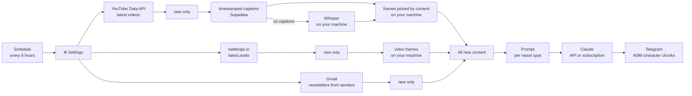

# Content Digest: an n8n workflow for YouTube, X and newsletter summaries

Every six hours this workflow collects what's new from the YouTube channels, X
accounts and newsletters you follow, has Claude write a report in Hungarian,
and posts it to Telegram. It never reports the same item twice.

The prompts focus on investment information: which asset each followed
investor talks about, which direction, which price levels, over what time
frame, how strongly they believe it, and whether they have money in it. The
levels are also read off the charts, from X post images and from frames cut
out of the videos. The workflow never gives investment advice of its own.

It's an n8n port of a Python system of mine and uses the same report rules.
The prompts and the reports are in Hungarian.


## How it works



- **Sources** are listed in the `⚙️ Settings` node. A new channel or account is
  one new line; no other node changes.
- **Deduplication:** each branch ends in a Remove Duplicates node, so no
  database is needed. On the first run, `lookbackHours` decides how far back
  to look.
- **Failures:** external calls use `On Error: Continue`, so one broken source
  doesn't stop the report. If the whole workflow fails, `error-alert.json`
  sends a Telegram message.
- **Charts in videos:** the people followed point at a chart and say "at this
  level", so the number is often missing from the transcript. A local service
  cuts frames from each video, mostly at the moments when the speaker points
  at the screen or says a number, and Claude gets them labelled with what is
  said at that moment.
- **Videos without captions** are transcribed by Whisper on your own machine.
  The report then notes that names and numbers may be off.

### Report types

Each type has its own prompt, its own Claude call and its own Telegram message.

| Type | Settings lists | What it's for |
|---|---|---|
| `investor` | `youtubeChannels`, `xAccounts`, `emailSenders` | Per-person investment analysis: claims, levels, time frame, conviction, charts included |
| `newsfeed` | `xNewsAccounts` | Accounts posting dozens of short items a day (e.g. @aixbt_agent): grouped by project, noise left out |
| `explainer` | `explainerChannels` | Non-investment educational videos: the argument, key concepts and practical steps |

The prompts are at the top of the `Build prompt` node. The output is plain
text, structured with emoji-led lines, because the Telegram node doesn't render
Markdown. Unlike the original, the model doesn't see the previous report, so it
can't say what changed since last time.

### Claude: API key or subscription

`claudeUrl` in the Settings node picks how the report is written:

| | Anthropic API | Claude subscription |
|---|---|---|
| `claudeUrl` | empty | the local service's address |
| Needs | an Anthropic API key | Claude Code logged in on the machine running the local service |
| Billing | per call | covered by the subscription |

Both get the same prompt and images. On a subscription, the local service runs
`claude -p` without tools or settings and answers in the API's format.

## Setup

**1. Start n8n:** `docker compose up -d`, then open `http://localhost:5678`. n8n
Cloud or a VPS works too, as long as it can reach the local service.

**2. Start the local service** (Whisper, frames, Claude subscription). It needs
Python 3.10+ and ffmpeg; an NVIDIA GPU helps but isn't required.

```powershell
cd whisper-service
pip install -r requirements.txt
$env:WHISPER_TOKEN = "<random value, at least 16 characters>"
python server.py
```

It listens on port 8790. From the Docker container n8n reaches it at
`http://host.docker.internal:8790`; check it at `http://localhost:8790/health`.
Optional environment variables: `WHISPER_MODEL` (`small` by default),
`WHISPER_MAX_MINUTES` (180), `WHISPER_PORT`, `WHISPER_HOST`.

**3. Import** `workflows/error-alert.json`, then `workflows/content-digest.json`
(Workflows → Import from File).

**4. Credentials.** Attach them to the matching nodes:

| Node | Type | Name | Value |
|---|---|---|---|
| YouTube (2 HTTP nodes) | Query Auth | `key` | YouTube Data API v3 key |
| Captions (Supadata), optional | Header Auth | `x-api-key` | Supadata key |
| Whisper, frames (2), Claude subscription | Header Auth | `X-Whisper-Token` | the service's token |
| X | Header Auth | `X-API-Key` | twitterapi.io key |
| Claude: summarize (API only) | Header Auth | `x-api-key` | Anthropic API key |
| Gmail | Gmail OAuth2 | | your mailbox |
| Telegram (send, error alert) | Telegram | | bot token from @BotFather |

The workflow files contain no keys. If you don't use a source, leave its list
empty and that branch won't run.

**5. Settings.** The main fields of the `⚙️ Settings` node:

```js
youtubeChannels:   ['UCjFCzjkgSShdRZIVJx3SSlQ'],   // investor; @handle works too
xAccounts:         ['ChifoiCristian'],             // investor
emailSenders:      ['newsletter@example.com'],     // investor
xNewsAccounts:     ['aixbt_agent'],                // newsfeed
explainerChannels: ['@tizeslista_hu'],             // explainer
whisperUrl:        'http://host.docker.internal:8790',
whisperLanguages:  ['hu', 'en', 'ro'],  // audio track to fetch (avoids auto-dubs)
framesPerVideo:    10,                  // 0 turns frames off
maxFramesPerReport: 30,
lookbackHours:     24,
telegramChatId:    '-100XXXXXXXXXX',
telegramChatIds:   { investor: '', newsfeed: '', explainer: '' },  // per-type chat, optional
model:             'claude-sonnet-5-5',
claudeUrl:         '',                  // empty: API; service address: subscription
```

**6. Test and activate.** Run it from the Manual trigger, set "Content Digest –
error alert" as the Error workflow in the workflow settings, then turn it on.

**Updating:** n8n doesn't pull new versions by itself. Save your lists from the
Settings node, re-import `workflows/content-digest.json`, put the lists back and
reattach the credentials. Changes are in the release notes.

## Details

- **Why not RSS:** YouTube's channel RSS feeds have returned 404 since October
  2026, so the workflow uses the Data API (2 quota units per channel per run,
  out of 10,000 a day).
- **Cost:** at most three Claude calls per run, one per report type. Their size
  is capped by `maxCharsPerItem`, `maxImages` and `maxFramesPerReport` (a frame
  is about 1,200 input tokens). Whisper and the frames run locally for free.
- **Testing:** tested end to end on n8n 2.8.4 with real content (a YouTube
  video, chart posts, a quoted video) against a mock of the external APIs,
  with the local service and Claude on a subscription running for real.


## Files

```
workflows/content-digest.json    the main workflow, prompts included
workflows/error-alert.json       error alert (Error Trigger → Telegram)
whisper-service/server.py        local service: Whisper, video frames, Claude subscription
whisper-service/moments.py       picks frame moments from the timestamped transcript
docker-compose.yml               local n8n with one command
README.hu.md                     this README in Hungarian
```
